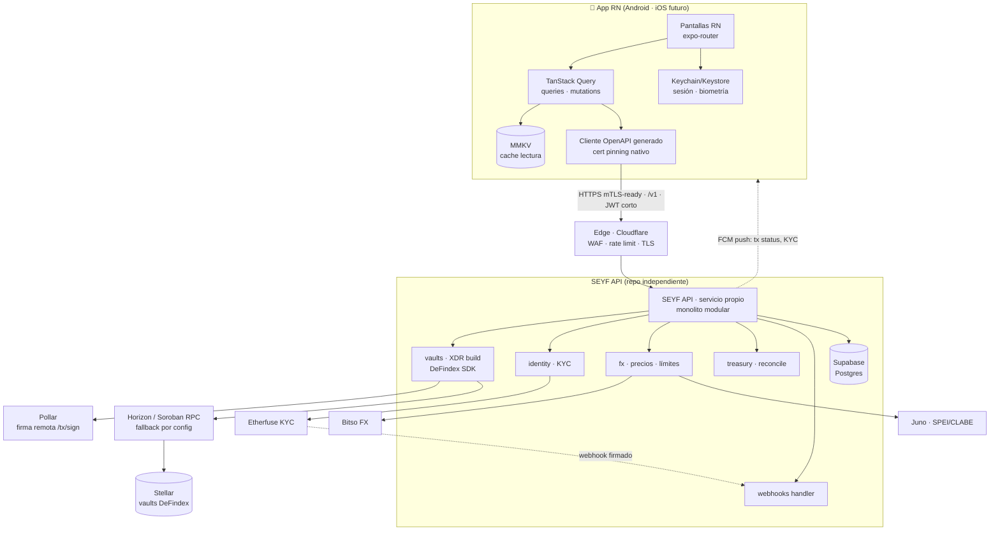

# SEYF Mobile + API — Arquitectura v0.2

> **Nota (2026-08-02)**: este repositorio, originalmente `Seyf-Android`, se reconvirtió en **`seyf-api`** — la extracción del backend es el camino crítico (Q2 resuelta). La app móvil (React Native + Expo, Q1 resuelta) vivirá en su propio repo. Ver [ADR 001](adr/001-stack-seyf-api.md).
> Estado: decisiones D1–D7 tomadas; quedan abiertas Q3–Q10 (sección 10).
> Fuente de verdad del negocio: [Seyfert-Labs/SEYF-P](https://github.com/Seyfert-Labs/SEYF-P) (WebApp, solo lectura).
> Fecha: 2026-08-01

---

## 1. Diagnóstico de la WebApp (lo que existe hoy)

Stack observado en SEYF-P:

| Capa | Tecnología | Rol |
|---|---|---|
| Frontend | Next.js 16, React 19, TS 5 | UI, hooks de negocio |
| Auth | Privy (email/OTP) | Identidad del usuario |
| Wallet | Pollar (headless, OTP/passkeys) | Custodia y **firma remota** (`/tx/sign`) — la llave privada nunca vive en el cliente |
| Blockchain | Stellar / Soroban | Bóvedas DeFindex (CETES ~10.5%, USDC ~4.5%, XLM ~2.8%) |
| Vaults | DeFindex SDK (server-side) | Construcción de XDRs de depósito/retiro |
| KYC | Etherfuse (+ webhooks firmados) | Verificación de identidad |
| FX / rieles | Bitso (MXN↔cripto), Juno (SPEI/CLABE) | On/off-ramp |
| DB | Supabase (Postgres) | Perfiles, metadata, ledger, estado KYC |
| BFF *de facto* | Next.js route handlers (`/api/*`) | Secretos, orquestación, treasury, webhooks |

Principios ya establecidos que la app móvil **debe heredar**:

1. **"Saldo real on-chain"** — los balances derivan de contratos DeFindex, no de la DB.
2. **Secretos solo en servidor** — API keys de DeFindex/Etherfuse/Bitso jamás llegan al cliente.
3. **Firma obligatoria del usuario** — toda transacción Stellar requiere firma vía sesión Pollar del usuario.

### 1.1 Deudas de la WebApp que NO debemos replicar en móvil

| Problema observado | Riesgo | Corrección en móvil |
|---|---|---|
| Tokens de sesión Pollar en `localStorage` | Robo de sesión por XSS / malware | Android Keystore + DataStore cifrado, acceso ligado a biometría |
| `waitForPollarSession()` con polling de 20 s | UX frágil, condiciones de carrera | Estados explícitos + backoff exponencial; idealmente push |
| BFF embebido en el repo del frontend web | Acoplamiento de despliegue; sin versionado; un breaking change web rompe móvil | Extraer a servicio API independiente y versionado (ver §2) |
| Sin contrato de API formal (OpenAPI) | Cada cliente adivina los shapes | Contrato OpenAPI como fuente de verdad + codegen |

---

## 2. Arquitectura general: crítica a la hipótesis "Relayer"

### 2.1 Veredicto

**La intuición es correcta; el nombre y el alcance, no.**

✅ **Correcto**: el cliente móvil NO debe hablar con RPCs, nodos, contratos, indexadores ni SDKs Web3. Este principio ya está probado en la WebApp y es la decisión más importante del proyecto. Se mantiene.

❌ **Incorrecto / sobredimensionado**: diseñar un "Relayer blockchain" genérico como pieza nueva. Razones técnicas:

1. **Vocabulario EVM en un stack Stellar.** Gas estimation, provider selection, RPC fallback multi-proveedor y account abstraction son problemas de Ethereum. En Stellar: fees de fracciones de centavo y predecibles; un RPC Horizon/Soroban (el fallback es una línea de configuración, no un componente); y Pollar **ya es** la capa de account abstraction y firma.
2. **El relayer ya existe distribuido en terceros.** Pollar firma, DeFindex construye XDRs, Etherfuse decide KYC, Bitso ejecuta FX. Construir un relayer propio duplicaría responsabilidades que hoy están delegadas con SLAs de terceros.
3. **Un "relayer" es infraestructura; lo que móvil necesita es un producto.** El cliente no quiere `POST /simulate-tx`; quiere `POST /v1/vaults/{id}/deposits`. La abstracción correcta se expresa en verbos de negocio, no de blockchain.

### 2.2 Lo que sí hay que construir: extraer el BFF existente

El movimiento arquitectónico correcto es **promover los route handlers de Next.js a un servicio independiente**: la **SEYF API**.

- **Un solo backend compartido** entre web y móvil, versionado (`/v1`), con contrato OpenAPI.
  - *No* un BFF por cliente (patrón BFF estricto): web y móvil tendrán paridad de features casi total; duplicar backends hoy es pagar dos mantenimientos por cero beneficio. Se divide **después**, si la divergencia lo exige (la modularización interna lo permitirá).
- **Sin API Gateway como producto** (Kong, Apigee): a escala de miles de usuarios es complejidad e infraestructura ociosa. Rate limiting, WAF y TLS en el edge (Cloudflare o equivalente) cubren lo mismo con costo ~cero.
- **Sin microservicios**: un monolito modular bien organizado (módulos `vaults`, `identity`, `fx`, `treasury`, `webhooks`) escala varios órdenes de magnitud más que la base de usuarios proyectada.
- **Migración incremental, sin tocar SEYF-P**: la SEYF API nace en repo propio reutilizando la lógica de `src/lib/*` y `src/app/api/*` como referencia (copiar/adaptar, no modificar el origen). La web sigue usando sus rutas actuales hasta que decida migrar; móvil consume solo la nueva API desde el día uno.

### 2.3 Qué vive dónde (regla de oro)

| Nunca en el cliente móvil | En la SEYF API | En terceros |
|---|---|---|
| API keys (DeFindex, Etherfuse, Bitso, Juno) | Construcción de XDRs | Firma (Pollar) |
| Construcción/parsing de XDR | Orquestación de flujos (depósito, retiro, conversión) | Decisión KYC (Etherfuse) |
| Lógica de treasury/reconciliación | Agregación de precios y cache | Ejecución FX (Bitso) |
| Manejo de webhooks | Rate limiting, idempotencia, auditoría | SPEI (Juno) |
| Acceso directo a Supabase con service key | Persistencia (Supabase server-side) | Consenso (Stellar) |
| Selección de RPC / lógica de red blockchain | Fallback de RPC (config), retries, observabilidad | |
| Decisiones de límites mensuales / compliance | Feature flags y metadata de vaults (server-driven) | |

**Multi-chain futuro**: la API expone capacidades (`/v1/vaults`, `/v1/deposits`, `/v1/balances`) — no cadenas. Si mañana SEYF agrega otra red, el cliente móvil **no cambia**. Este es el argumento más fuerte a favor de tu instinto de BFF, y la razón por la que la abstracción debe ser de producto, no de infraestructura.

### 2.4 Punto sensible: ¿el cliente habla directo con Pollar para firmar?

Dos opciones:

| | A. Directo Android → Pollar | B. Proxy vía SEYF API |
|---|---|---|
| Superficie de pinning | 2 hosts pinneados (SEYF + Pollar) | 1 host |
| Observabilidad de firmas | Parcial | Total (auditoría centralizada) |
| Latencia | Menor | +1 salto |
| Trust path | La API no ve el flujo de firma | La API ya construye el XDR, así que **ya está** en el trust path |

**Recomendación: B (proxy)**, porque la SEYF API ya es quien construye el XDR — proxear la firma no amplía el trust path y sí simplifica pinning, auth unificada y auditoría. Se revisa si Pollar exige interacción directa del dispositivo (p. ej. passkeys/FIDO2 — pregunta abierta Q4).

---

## 3. Arquitectura móvil

> ✅ **Q1 resuelta (2026-08-01): React Native + Expo.** Razones: el mismo equipo web (TS/React) mantendrá la app, e iOS está a <12 meses. Kotlin nativo habría implicado reescribir el 100 % de la lógica ahora y repetir la reescritura para iOS, con un equipo sin experiencia en ninguno de los dos stacks nativos. KMP se descartó: no comparte nada con un equipo TS ni con la web. El costo de RN (seguridad de plataforma vía módulos puente, no de primera clase) se mitiga explícitamente en §5.1.

**Advertencia de alcance — qué se reutiliza y qué no**: React Native comparte lenguaje, modelo mental y lógica con SEYF-P, **no el DOM**. Los hooks de datos, validaciones, formateo y flujos portan casi 1:1; las pantallas (JSX con divs/Tailwind) se **reescriben** con primitivas RN. La migración de UI es de *diseño y comportamiento*, no copy-paste de componentes.

### 3.1 Decisiones y justificación

| Decisión | Elección | Por qué |
|---|---|---|
| Framework | **React Native + Expo** (dev builds + EAS), TypeScript `strict` | Un solo lenguaje para web y móvil; iOS <12 meses con la misma base de código |
| Navegación | expo-router (file-based) | Mismo modelo mental que el App Router de Next.js que el equipo ya conoce |
| Server state | **TanStack Query** | Los 16 hooks de SEYF-P se portan a queries/mutations casi directo; cache, retry y staleness resueltos por diseño |
| Estado local/UI | Zustand | Equivalente natural del `store.ts` de la web; mínima ceremonia |
| Red | Cliente **generado desde OpenAPI** (orval → hooks de TanStack Query) | El contrato es la fuente de verdad; prohibido escribir DTOs/fetchers a mano |
| Estilos | NativeWind si SEYF-P usa Tailwind; si no, tokens del `seyf-brand-kit` + StyleSheet | Maximiza transferencia del design system web |
| Persistencia | MMKV + TanStack Query persister (cache lectura); llavero seguro para sesión (§5.1) | Ver política offline abajo |
| JS engine / updates | Hermes; **EAS Update con code signing** para fixes JS | Política estricta: cambios en flujos de firma/auth **nunca** van por OTA, siempre por release de tienda |

### 3.2 Offline: crítica al "Offline First"

**"Offline first" es la política equivocada para una app de saldos y transacciones.** El principio de SEYF es "saldo real on-chain"; un saldo servido desde cache sin señalización es un bug financiero, y una transacción encolada offline que se ejecuta horas después a otro precio es un incidente.

Política correcta — **offline-readable, never offline-writable**:

- ✅ Cache de lectura (Room): últimos balances, posiciones, historial — siempre con timestamp visible de "actualizado hace X".
- ✅ La app abre y muestra el último estado conocido sin red.
- ❌ Cero encolamiento offline de depósitos, retiros o conversiones. Sin red → CTA deshabilitado con explicación.
- ✅ Toda mutación con **idempotency key** generada en cliente, para que un retry por timeout nunca duplique una transacción.

### 3.3 Mapa de migración WebApp → Android

La lógica de los hooks de la WebApp es la especificación funcional de los repositorios móviles:

| Hook (SEYF-P) | Contraparte móvil (RN) | Estrategia |
|---|---|---|
| `useStellarVaults`, `useVaults`, `useDefindexStrategies` | Queries TanStack en `features/vaults` | **Portar** la lógica; los fetchers los reemplaza el cliente OpenAPI generado |
| `useKycStatus` | Query en `features/kyc` | Portar |
| `useConversions`, `useBitsoRates`, `useAssetPricesMxn` | Queries en `features/convert` (precios servidos por la API, no por el cliente) | Portar + **abstraer al backend** la agregación de precios |
| `usePendingTxns`, `useStellarTxns` | Queries + push/polling en `features/transactions` | Portar |
| `useUserBanks`, `useUserClabe`, `useMonthlyLimits` | Queries en `features/banking` | Portar; los límites los **decide el backend** |
| `useOnchain`, `sdex`, `chain.ts` | — | **No migrar al cliente**: absorber en SEYF API |
| Flujos UX (onboarding, depósito, retiro, KYC) | Pantallas RN (expo-router) | **Migrar el diseño y los flujos**; el JSX web (DOM) se reescribe con primitivas RN |
| `src/lib/*` (defindex, bitso, etherfuse, juno, pollar server-side) | — | **Nunca en el cliente**: base de la SEYF API |

---

## 4. Comunicación



Flujo de un depósito (patrón para toda mutación):

1. `POST /v1/vaults/{id}/deposits` con `Idempotency-Key` → la API valida límites/KYC, construye XDR (DeFindex SDK), devuelve `depositId` + resumen humano-legible de lo que se va a firmar.
2. La app muestra el resumen → el usuario confirma con **biometría local** → `POST /v1/deposits/{id}/confirm` → la API solicita firma a Pollar con la sesión del usuario → submit a Stellar.
3. Estado por push (FCM) con fallback de polling con backoff. Nunca un `sleep(20s)`.

---

## 5. Seguridad

### 5.1 En el dispositivo

> En React Native, la seguridad de plataforma llega vía módulos nativos — es el costo aceptado de la decisión Q1. Estas medidas son **requisito de release**, no opcionales, y son la respuesta directa a esa debilidad.

| Área | Medida |
|---|---|
| Sesión/tokens | Access token corto (≤15 min) + refresh con rotación y detección de reuso. El refresh token en **react-native-keychain con acceso ligado a biometría** (`BIOMETRY_CURRENT_SET`, respaldado por Android Keystore / StrongBox) — no en expo-secure-store plano ni en AsyncStorage jamás |
| Biometría | La biometría desbloquea una llave real del Keystore que protege el refresh token — no un `if (isAuthenticated)` decorativo en JS, que cualquier hook de Frida salta |
| Cert pinning | Solo contra el host de SEYF API, configurado **en capa nativa** (config plugin de Expo → OkHttp CertificatePinner; TrustKit cuando llegue iOS), **con pines de respaldo y plan de rotación** documentado. Terceros no se pinnean: se proxean (§2.4) |
| Integridad | **Play Integrity API** (módulo nativo) verificada server-side en operaciones sensibles (alta de cuenta bancaria, retiro). Root detection como *señal de riesgo*, no como bloqueo binario |
| Ingeniería inversa | Hermes bytecode + R8 en la capa nativa. Ser honestos: un bundle JS es más inspeccionable que Kotlin ofuscado — razón de más para que **ningún secreto ni regla de negocio viva en el cliente**; la seguridad real es que no hay nada que robar |
| OTA updates | EAS Update **con code signing**; política escrita: flujos de firma, auth y manejo de sesión nunca se modifican por OTA, solo por release de tienda revisado |
| Pantallas | `FLAG_SECURE` vía expo-screen-capture en pantallas financieras; enmascarar en app-switcher |
| WebViews | Evitarlas para flujos de auth/firma salvo que un tercero lo exija (Q3/Q4) |

### 5.2 En la API

- AuthN: Privy (o equivalente) verificado server-side; la API emite sus propios JWT — el cliente nunca maneja tokens de terceros de larga vida.
- AuthZ: toda regla (límites mensuales, estado KYC, elegibilidad de vault) se **evalúa en servidor**; el cliente solo la refleja.
- Idempotencia obligatoria en mutaciones; auditoría append-only de cada solicitud de firma.
- Webhooks Etherfuse: validación de firma + anti-replay (ya práctica en la WebApp — conservar).
- Rate limiting por usuario y por IP en el edge.

### 5.3 Riesgo estructural a documentar (no resolver en móvil)

Pollar firma server-side con la sesión del usuario ⇒ el modelo es **custodial-en-la-práctica** respecto a Pollar. No es un defecto de la app móvil, pero determina el threat model (y posiblemente el encuadre regulatorio — Q6). La app debe, como mínimo, garantizar que ninguna firma ocurra sin confirmación biométrica local explícita del usuario.

---

## 6. Escalabilidad

| Dimensión | Estrategia |
|---|---|
| Miles de usuarios | Monolito modular + Postgres + cache de precios: sobra. No optimizar antes de medir |
| Múltiples chains | Invisible para móvil por diseño (§2.3): la API traduce capacidades → cadena |
| Nuevas vaults/estrategias | **Server-driven metadata**: la lista de vaults, APYs, límites y flags llegan de `/v1/vaults` — publicar una vault nueva no requiere release de app |
| Nuevas features | Feature flags server-side (kill-switch por feature y por versión mínima de app) |
| Versionado | `/v1` estable; la API soporta N y N-1; **forced update** implementado desde el día 1 (endpoint `/v1/app/minimum-version`) — es la válvula de escape que evita mantener clientes rotos para siempre |

---

## 7. Experiencia del desarrollador

### 7.1 Estructura del proyecto (React Native + Expo)

```
seyf-mobile/
├── app/                      # expo-router: rutas = pantallas
│   ├── (auth)/               # onboarding, login, creación de wallet
│   └── (tabs)/               # vaults (home), convert, transactions, profile
├── src/
│   ├── features/             # lógica por feature (queries, components, types)
│   │   ├── vaults/
│   │   ├── kyc/
│   │   ├── convert/
│   │   ├── banking/
│   │   └── transactions/
│   └── core/
│       ├── api/              # cliente OpenAPI generado (orval), interceptors
│       ├── auth/             # sesión, keychain, biometría
│       ├── design-system/    # tokens del seyf-brand-kit, componentes base
│       ├── storage/          # MMKV, query persister
│       └── config/           # env por entorno, feature flags
└── docs/                     # ADRs, este documento
```

Reglas: `features/* → core/*` solamente; features no se importan entre sí (navegan por rutas de expo-router); `core/*` no conoce features. Nota sobre compartir código con SEYF-P: prohibido tocar ese repo, así que los hooks se **portan** (copiar y adaptar) — un monorepo con paquetes compartidos es una opción futura *si la web decide migrarse*, no un prerequisito.

### 7.2 Convenciones y proceso

- **Estilo**: ESLint + Prettier en CI, bloqueantes; TS `strict`; heredar las reglas de SEYF-P donde apliquen para que el equipo no cambie de dialecto entre repos.
- **Git**: trunk-based, ramas cortas (`feature/`, `fix/`), Conventional Commits, PR obligatorio con CI verde. Sin gitflow: para un equipo pequeño es fricción pura.
- **CI/CD (GitHub Actions + EAS)**: PR → lint + typecheck + unit; `main` → **EAS Build** + submit automático a Play Internal track; promoción a closed/production manual. EAS Update para hotfixes JS bajo la política de §5.1.
- **Testing (pirámide)**: unit (hooks y lógica con Jest + React Native Testing Library; red mockeada con **MSW contra el contrato OpenAPI**, no mocks manuales) → tests de componentes del design system → E2E críticos con **Maestro** (login, depósito en testnet). Objetivo honesto: cobertura alta en `features/` y `core/`, no un % vanity global.
- **Documentación**: ADRs (`docs/adr/NNN-*.md`) para cada decisión relevante — empezando por las de este documento. El contrato OpenAPI vive con la SEYF API y es la referencia, no un wiki.
- **Codegen**: cliente de red generado desde OpenAPI en CI (orval → hooks TanStack Query tipados); prohibido escribir DTOs a mano.

---

## 8. Roadmap técnico

> Las fases 2–5 de app dependen de que exista la SEYF API (fase 1b). Ese es el camino crítico del proyecto.

### Fase 0 — Investigación (1–2 semanas)
- **Objetivo**: resolver las preguntas Q1–Q6 (§10); validar SDKs de Privy y Pollar en Android; acceso a testnet.
- **Entregables**: decisiones registradas como ADRs; spike de auth Privy + firma Pollar end-to-end en un proyecto desechable.
- **Riesgos**: que Privy/Pollar no tengan camino Android viable → cambia la fase 5 por completo.
- **Éxito**: un APK de prueba autentica y firma una tx en testnet, aunque sea feo.

### Fase 1 — Arquitectura (1–2 semanas, paralelo con 1b)
- **Objetivo**: cerrar este documento; definir contrato OpenAPI v1 (vaults, identity, fx, transactions, session).
- **Entregables**: ADRs aprobados; `openapi.yaml` v0 revisado contra los shapes reales de la WebApp.
- **Dependencias**: Fase 0.
- **Riesgos**: diseñar la API sin mirar los shapes reales de SEYF-P → drift conceptual con la web.
- **Éxito**: el contrato cubre el 100 % del MVP móvil sin endpoints "por si acaso".

### Fase 1b — Extracción de la SEYF API (2–4 semanas, equipo backend)
- **Objetivo**: servicio independiente con la lógica de `src/lib/*` portada; SEYF-P intacto.
- **Entregables**: SEYF API v1 desplegada (staging) con auth, vaults read, build+sign+submit de depósito, KYC status, precios.
- **Riesgos**: divergencia silenciosa con la lógica web → mitigar con tests de contrato comparando respuestas.
- **Éxito**: un depósito completo en testnet vía la nueva API, sin tocar el repo web.

### Fase 2 — Bootstrap del proyecto (1 semana)
- **Objetivo**: esqueleto Expo (dev builds), estructura de §7.1, CI + EAS, design system base, codegen OpenAPI conectado.
- **Entregables**: repo compilando en CI, ESLint/TS strict, primera pantalla con theming SEYF, pipeline EAS a Internal track.
- **Éxito**: un PR de ejemplo pasa por todo el pipeline hasta un APK instalable.

### Fase 3 — Migración de UI (3–5 semanas)
- **Objetivo**: pantallas del MVP (onboarding, home/vaults, detalle, historial, KYC) contra **datos mock del contrato**.
- **Dependencias**: Fase 2; contrato de Fase 1 (no necesita la API viva).
- **Riesgos**: "parity total con la web" como meta implícita → definir el corte de MVP explícitamente (Q9).
- **Éxito**: flujo demo navegable con mocks; screenshot tests del design system en verde.

### Fase 4 — Networking (1–2 semanas)
- **Objetivo**: sustituir mocks por SEYF API staging; cache Room; estados offline-readable; manejo de errores unificado.
- **Dependencias**: Fases 1b y 3.
- **Éxito**: la app opera contra staging con red intermitente sin estados rotos.

### Fase 5 — Autenticación y sesión (2–3 semanas)
- **Objetivo**: Privy (o el camino elegido en Fase 0), sesión con Keystore, biometría, refresh rotation, pinning.
- **Riesgos**: el mayor del proyecto — SDKs de terceros en Android con documentación inmadura. El spike de Fase 0 existe para des-riesgar esto.
- **Éxito**: login, sesión persistente segura y re-auth biométrica; pen-test interno básico del flujo.

### Fase 6 — Integración blockchain (2–3 semanas)
- **Objetivo**: depósito/retiro/conversión reales end-to-end en testnet vía API + Pollar; push de estado de tx.
- **Dependencias**: Fases 4 y 5.
- **Éxito**: ciclo completo depósito→rendimiento visible→retiro en testnet desde el teléfono.

### Fase 7 — Testing y hardening (2–3 semanas)
- **Objetivo**: E2E Maestro, Play Integrity server-side, revisión de seguridad externa si el presupuesto lo permite, performance (arranque en frío, baseline profiles).
- **Éxito**: suite E2E verde en CI; checklist de seguridad (§5) auditado; crash-free objetivo definido.

### Fase 8 — Release (1–2 semanas + beta)
- **Objetivo**: closed beta → producción. **Atención**: Google Play exige declaraciones para apps financieras (y en varios países, evidencia regulatoria) — iniciar ese papeleo en Fase 0, no aquí (Q6).
- **Éxito**: publicada, forced-update operativo, observabilidad (Crashlytics + métricas de API por versión de app) en dashboard.

---

## 9. Resumen de decisiones propuestas

| # | Decisión | Estado |
|---|---|---|
| D1 | Cliente móvil 100 % blockchain-agnóstico (API de producto, no relayer) | Propuesta firme |
| D2 | Extraer BFF de Next.js → SEYF API independiente, versionada, OpenAPI | **Decidida** (Q2: hay 1+ persona dedicada, timeline flexible → extracción completa, Fase 1b) |
| D3 | Un backend compartido web+móvil; sin gateway comercial; sin microservicios | Propuesta firme |
| D4 | **React Native + Expo, TypeScript** (TanStack Query, expo-router, cliente OpenAPI generado) | **Decidida** (Q1: equipo web TS + iOS <12 meses) |
| D5 | Offline-readable, never offline-writable; idempotency keys | Propuesta firme |
| D6 | Firma proxy vía SEYF API; biometría local obligatoria antes de firmar | Condicionada a Q4 |
| D7 | Server-driven vaults + feature flags + forced update desde el día 1 | Propuesta firme |

---

## 10. Preguntas abiertas (priorizadas — bloquean la arquitectura definitiva)

**Q1. ¿Nativo Kotlin, React Native/Expo o KMP?** — ✅ **RESUELTA (2026-08-01): React Native + Expo.** El mismo equipo web (TS/React) mantendrá la app y iOS está a <12 meses — el escenario donde Kotlin obliga a reescribir todo dos veces con un equipo sin experiencia nativa. Costo aceptado: la seguridad de plataforma llega vía módulos nativos (mitigaciones obligatorias en §5.1) y las pantallas se reescriben con primitivas RN (el DOM no porta). Beneficio adicional: Privy y varios proveedores Web3 tienen SDK React Native/Expo de primera clase, lo que mejora el pronóstico de Q3.

**Q2. ¿Hay equipo/presupuesto para extraer la SEYF API (Fase 1b)?** — ✅ **RESUELTA (2026-08-01): sí — Opción A, extracción completa.** Hay al menos una persona (perfil TS) que puede dedicarse 2–4 semanas, y el timeline es flexible con prioridad en calidad. La Fase 1b procede como está descrita: repo `seyf-api` propio, lógica portada de `src/lib/*` módulo a módulo (vaults primero), `/v1` + OpenAPI, despliegue independiente, JWT propios para móvil.
  - *Mitigación obligatoria del riesgo de divergencia*: mientras la web siga usando sus rutas viejas, tests de contrato comparan respuestas de ambas implementaciones; la duplicación tiene fecha de caducidad (la web migra módulo a módulo después).
  - *Fallback si la capacidad cambia*: patrón **strangler fig** — la SEYF API nace como fachada delgada (`/v1` + auth móvil propia) que reenvía a las rutas Next.js existentes, y la lógica se porta detrás de la fachada gradualmente. Móvil no notaría la diferencia; se pierde ~1 semana, no las 4.
  - *Nota*: el "plan B puro" (móvil consumiendo rutas Next.js directamente) queda **descartado**: acopla deploys web↔móvil y casi seguro requeriría modificar SEYF-P para aceptar auth por Bearer token, violando la restricción de no tocar ese repo.

**Q3. ¿El SDK React Native/Expo de Privy cubre el flujo actual (email/OTP) tal como lo usa SEYF-P?** — Privy publica `@privy-io/expo`, lo que hace esta pregunta mucho más tratable que con Kotlin nativo, pero hay que validar en el spike de Fase 0 que soporta el flujo exacto de la web y su modelo de sesión. Plan B: auth custom vía SEYF API con Privy server-side.

**Q4. ¿Cómo funciona Pollar desde móvil?** — ¿La sesión OTP/passkey puede originarse en Android (Credential Manager / FIDO2)? ¿Pollar exige interacción directa del dispositivo o todo pasa por API? Determina D6 y parte del threat model.

**Q5. ¿La WebApp accede a Supabase directamente desde el navegador (anon key + RLS)?** — Para móvil propongo prohibirlo (todo vía API), pero hay que confirmar qué hace la web hoy para no romper paridad conceptual de datos.

**Q6. Encuadre regulatorio y de Play Store** — Custodia práctica en Pollar + rieles SPEI: ¿aplica Ley Fintech/CNBV o se opera bajo el paraguas de Bitso/Juno? Google Play exige declaración de app financiera y en algunos mercados evidencia de registro. Esto tiene lead time largo: arrancarlo en Fase 0.

**Q7. ¿Existe infraestructura de push?** — El estado de transacciones y KYC por polling es la deuda UX de la web; FCM requiere soporte del backend (¿existe algo hoy?).

**Q8. Timeline de mainnet** — El roadmap web dice "mainnet deployment" pendiente. ¿Móvil nace contra testnet? ¿El release de móvil (Fase 8) depende del audit de contratos?

**Q9. Corte de MVP móvil** — ¿Qué subconjunto de features de la web entra en la v1? Propuesta inicial: onboarding + KYC + vaults (depósito/retiro) + historial. ¿Convert y banking/SPEI entran o esperan?

**Q10. Equipo** — ¿Cuántas personas, qué perfiles (Android/backend/TS)? Cambia la respuesta a Q1 y la duración realista de cada fase.
